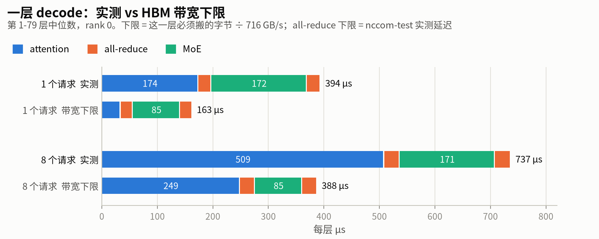
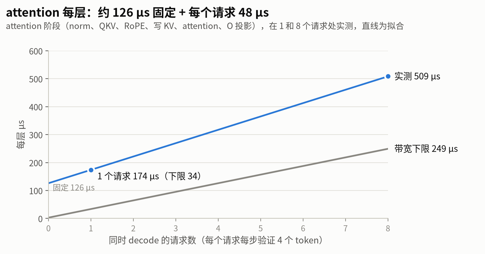
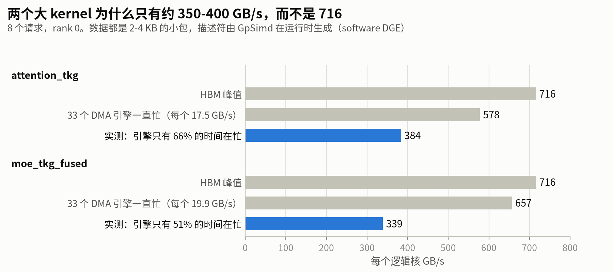

# Where a decode step goes on Trn2 (dense attention, DMA-traced profile)

Profiled on one trn2.48xlarge (TP64 / EP64, LNC 2) at `hy3-fp8-contrib` e891054. The question was why
Hy3 decode runs far below what the hardware should allow when no single resource is saturated:
not the collectives, not the FLOPs, not HBM bandwidth.

Short answer:
- Every part of a layer runs at 20-55% of its HBM-bandwidth bound.
- Most of the gap is the cost of moving each rank's small per-layer data in 2 KB DMA pieces. Their
  descriptors are generated at run time (software DGE on GpSimd), so the DMA engines are idle
  35-50% of the kernel time and run at about 18-20 GB/s each when busy.
- On top of that, the attention kernel has about 125 us of fixed cost per layer.
- The two all-reduces per layer (24-29 us each) overlap almost nothing.

## Setup

`scripts/profile_85k.sh` with FP8 KV, MTP k=3 and the fused decode MoE for every decode size
(`HY3_DECODE_MOE_FUSED=1 HY3_DECODE_HITS=0`, as `serve_agentx.sh`). There is no sparse attention.
Other settings:
- `NEURON_RT_EXEC_TIMEOUT=1200`: stopping a DMA-traced session stalls the profiled ranks for
  longer than the default 30 s, and the other ranks then fail with `NRT_EXEC_HW_ERR_COLLECTIVES`.
- `KV_CAP=0.40` and `VLLM_NEURON_MAX_KV_CONCURRENT=8`.
- `PROFILE_RANKS='[0, 36]'`; the tables are rank 0.

The prompts are the 85k ones with a 78k shared prefix (`profile_85k_client.py`). Two sessions:
- c1: 1 request decoding (batch-1 NEFF);
- c8: 8 requests decoding (batch-8 NEFF, no padding).

Each decode step verifies 4 tokens per request.

Export and analysis:
1. Export with `neuron-explorer view -d <ntff + NEFFs> --output-format parquet --ignore-nc-buf-usage --disable-ui`.
   DMA tracing is on, which is the profiler default.
2. Analyze with `scripts/profile_block.py`, `profile_kernel.py`, `profile_dma_packets.py` and
   `profile_dma_engines.py`.

Raw outputs are in `results/profile_decode_block/`. The figures are drawn by `scripts/plot_decode_block.py` (matplotlib, Noto Sans CJK)
from those outputs and from one layer's timeline (`scripts/profile_timeline.py`).

`profile_block.py` cuts the timeline at the all-reduces: one for the embedding, then two per layer.
The per-instruction layer tags are not usable for this: deduplicated kernels carry one layer's tag
for the whole step.

## The step

| | c1 | c8 |
|---|---|---|
| target NEFF | 32.5 ms | 60.0 ms |
| MTP draft NEFF | 3.0 ms | 3.9 ms |
| gap between NEFF executions (host) | 0.09 ms | 0.07 ms |

## One layer (layers 1-79, median)

The bound is the HBM bytes the layer must move at 716 GB/s, one logical core's HBM stack:
- KV: 86016 positions x 256 B (FP8 K + V, 1 KV head) = 22 MB per request;
- attention weights: QKV + O, 2.1 MB;
- MoE: 3 routed experts 56.6 MB + the shared-expert decode shard 2.4 MB + the router 1.6 MB.

The collective bound is nccom-test's 64-rank all-reduce at the same size.

| per layer | c1 measured | c1 bound | c8 measured | c8 bound |
|---|---|---|---|---|
| attention (norm, QKV, RoPE, KV write, attention, O-proj) | 174 us, 24 MB (139 GB/s) | 34 us | 509 us, 199 MB (391 GB/s) | 249 us |
| all-reduce after attention | 24 us | 22 us | 28 us | 27 us |
| MoE (fused kernel: norm, router, routed + shared experts) | 172 us, 61 MB (356 GB/s) | 85 us | 171 us, 51 MB (301 GB/s) | 85 us |
| all-reduce after MoE | 25 us | 22 us | 29 us | 27 us |
| **layer** | **395 us** | **163 us** | **739 us** | **388 us** |

The 80 layers at the bound would take 13.0 ms (c1) and 31.0 ms (c8), against 32.5 ms and 60.0 ms
measured: c1 runs at 40% of the bound and c8 at 52%.

Attention is about 126 us fixed plus 48 us per request. The slope reads one request's 22 MB of KV at
about 460 GB/s, 64% of HBM. MoE does not depend on the batch.

## One layer on the device

Layer 40 of one step, rank 0 (figure labels in Chinese):
- each row is one engine; a bar means it is executing an instruction;
- the orange row and the grey bands are the two all-reduces;
- the strip at the bottom is the DMA throughput.

There is no "DMA active" row: tiny completion packets (4-32 B) keep some queue busy almost all the
time, so the throughput is the useful view. For the same reason the "DMA active" times in the kernel
tables below are upper bounds.

How to read them:
- **Attention at 1 request.** The throughput stays at 100-350 GB/s for the whole phase, and no engine
  row is full. Every engine waits on the others.
- **Attention at 8 requests.** Throughput reaches 500-700 GB/s only in bursts and dips between them.
  At 85-130 us it is about zero while TensorE and VectorE compute: loads and compute take turns
  instead of overlapping.
- **MoE.** Weight streaming reaches 400-650 GB/s, and TensorE works in blocks between the loads.
- **The all-reduces.** Every row is empty there, and the DMA throughput is about zero.

## Attention kernel (`attention_tkg`)

| per layer | c1 | c8 |
|---|---|---|
| kernel time | 128 us | 429 us |
| DMA | 16.6 MB, 7,500 packets of 2-4 KB (99% of the bytes) | 165 MB, 77,000 packets of 2-4 KB |
| DMA active / rate while active | 109 us / 153 GB/s | 414 us / 399 GB/s |
| Tensor busy | 62 us (2,082 LDWEIGHTS + MATMUL pairs) | 254 us (10,872 pairs) |
| GpSimd busy | 65 us | 286 us (80 `DMA_GATHER_TRANSPOSE` at 3.5 us, 40 `DMA_INDIRECT` at 2.7 us) |
| Vector busy | 49 us | 144 us |

c8, per DMA engine (`profile_dma_engines.py`):
- the 33 engines carrying its traffic are busy 66% of the kernel time;
- when busy, each moves 17.5 GB/s. A 2 KB software-DGE packet takes about 100 ns;
- 33 x 17.5 GB/s x 0.66 = 384 GB/s.

Busy all the time, the same packets would give about 580-670 GB/s.

What bounds it:
- **The KV is read in 2 KB pieces.** One KV head per rank and 32-token paged blocks give 4 KB of K
  per block. The packed FP8 layout splits that into 2 KB rows.
- **The descriptors of this paged gather are built at run time by GpSimd.** GpSimd is busy two thirds
  of the kernel time, so the DMA queues wait on it.
- **The kernel is a chain:** gather K, QK^T, softmax, gather V, PV. Each stage depends on the one
  before it, and every 128-token tile costs a weight load into the PE array for only 4 query
  columns: 1 Q head x 4 verify tokens at TP64.
- **No engine is saturated.** The step is bound by the latency of the hand-offs, and at c1 that is
  what the fixed ~125 us per layer is.

The remaining ~46 us per layer of the attention phase at c1 is the rest of the attention block:
- `attention_block_tkg` glue and cache write, 19-25 us;
- O-proj 11 us, QKV 9 us, the broadcast 9 us, RMSNorm 4 us, RoPE 3 us.

## MoE kernel (`moe_tkg_fused`)

| per layer | c1 | c8 |
|---|---|---|
| kernel time | 166 us | 191 us |
| DMA | 57 MB, 21,000 packets of 2-4 KB | 65 MB, 25,000 packets of 2-4 KB |
| DMA active / rate while active | 147 us / 389 GB/s | 171 us / 379 GB/s |
| Tensor / GpSimd / Vector busy | 108 / 105 / 99 us | 108 / 118 / 106 us |

c8: the DMA engines are busy 51% of the kernel time, at 20 GB/s each when busy (84 ns per 2 KB
packet). GpSimd spends about 148 us per layer on `DMA_DIRECT2D`, generating the weight streams'
descriptors.

The single-core benchmark of the routed part (0.127 ms, README "Fused decode MoE") is the kernel
alone. In the model the whole MoE block takes 166-191 us, about 2x its HBM bound.

## Collectives and overlap

While each all-reduce runs, any engine is busy for:
- after attention: 1% (c1) and 1% (c8) of its time;
- after MoE: 20% (c1) and 23% (c8), moving 0.4-2.9 MB.

That is 3.9 ms (c1) and 4.6 ms (c8) per step with nothing overlapped: 12% and 8% of the target.

Each all-reduce sits on the dependency chain:
- the MoE needs the attention's all-reduce;
- the next layer needs the MoE's.

So only independent work can hide them, mainly the next kernel's weight loads (about 11 MB
fit in 28 us at 400 GB/s). Neither the compiler nor the kernels schedule such a prefetch across a
kernel boundary today. The megakernel prototype (8 layers in one NKI kernel, no explicit DMA
schedule) did not change device time.

## Why the model maps badly onto the machine

- **Each rank's work per layer is small.** Using the machine's 46 TB/s takes 64 ranks:
  - each rank has 1 Q head, 1 replicated KV head and 3 experts of 18.9 MB;
  - a layer moves 24-200 MB in 4-32 tokens of compute.
- **Trn2 moves that data with DMA descriptors.** Paged KV and per-expert weight rows give 2-4 KB
  descriptors, generated on GpSimd at run time. The DMA engines then idle 35-50% of the time and
  run at about 75% of their rate when busy, which puts both big kernels near 400 GB/s per core.
  A GPU streams the same bytes as loads from many SMs, with no descriptor stage.
- **Each layer also pays fixed costs:** ~125 us in the attention kernel, ~50 us of block glue and
  two 64-rank all-reduces of 24-29 us with no overlap. 80 layers repeat it, and at c1 that is more
  than half of the step.

Under the same features (FP8 KV + MTP k=3, chat traffic, C = 8) the 1P1D decode-only TPOT is
19.7 ms on Trn2 and 11.0 ms on H100 (README, "Decode at C = 10 / 12").

## What would move it

Per-step gains are at c8, estimated from the tables above, not measured.

| change | where | possible gain |
|---|---|---|
| keep the DMA engines fed in `attention_tkg`: KV descriptors precomputed or hardware DGE, the next tile's gather issued before the current softmax | attention, 429 us/layer at c8 | toward ~250-300 us/layer: 10-14 ms |
| larger contiguous KV pieces (64/128-token blocks, or a head-major layout so one descriptor covers more than 2 KB) | attention | part of the above; changes the KV block size and prefix caching |
| the same for `moe_tkg_fused`: engines are busy 51% | MoE, 171-191 us/layer | toward ~110 us: ~5-6 ms |
| prefetch the next kernel's weights during each all-reduce (needs cross-kernel scheduling or a multi-layer kernel with an explicit DMA order) | 2 x 24-29 us/layer | up to ~4 ms |
| fold the attention block's glue (norm, broadcast, cache write) into fewer instructions | ~46 us/layer | ~2 ms |

The first three are NKI-kernel / compiler work on `attention_tkg` and the DMA path. The model code
here only chooses layouts and block sizes.
