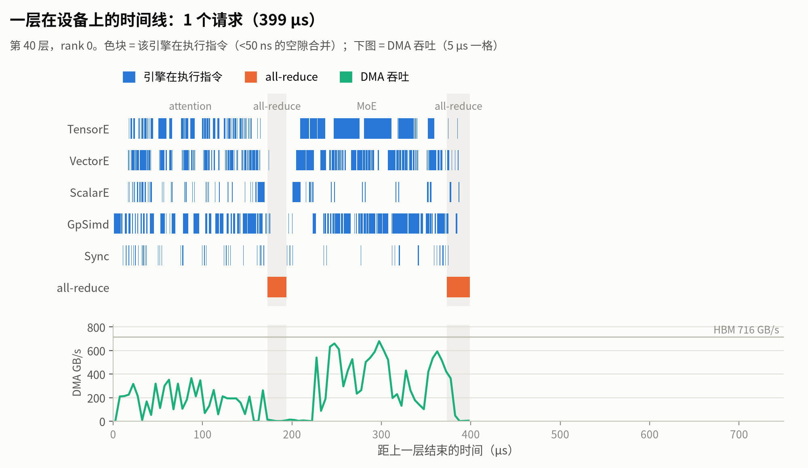
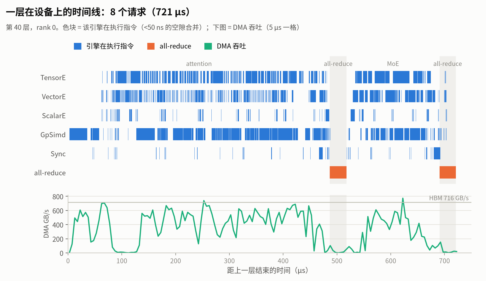
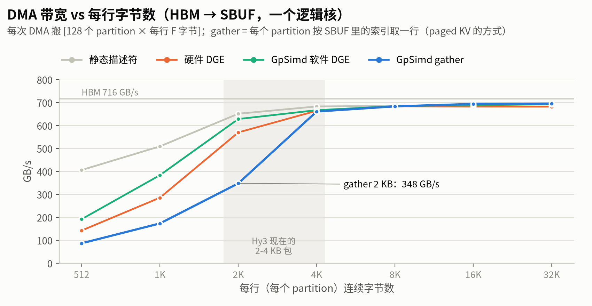
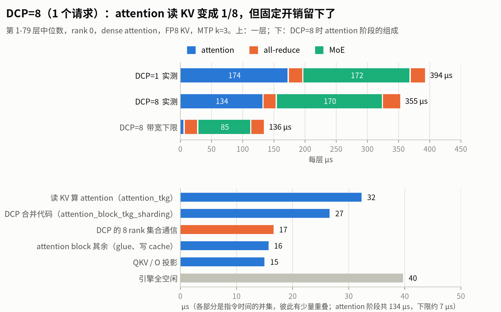

# Where a decode step goes on Trn2 (dense attention, DMA-traced profile)

Profiled on one trn2.48xlarge (TP64 / EP64, LNC 2) at `hy3-fp8-contrib` e891054. The question was why
Hy3 decode runs far below what the hardware should allow when no single resource is saturated:
not the collectives, not the FLOPs, not HBM bandwidth.

Short answer:
- Every part of a layer runs at 20-55% of its HBM-bandwidth bound.
- Most of the gap is in how each rank's small per-layer data is moved by DMA:
  - attention gathers the paged KV in 2 KB rows, an access that a microbenchmark caps at 348 GB/s,
    half of HBM;
  - the MoE kernel keeps its DMA engines busy only about half the time.
- On top of that, the attention kernel has about 125 us of fixed cost per layer.
- The two all-reduces per layer (24-29 us each) overlap almost nothing.

## Setup

`scripts/profile_85k.sh` with FP8 KV, MTP k=3 and the fused decode MoE for every decode size
(`HY3_DECODE_MOE_FUSED=1 HY3_DECODE_HITS=0`, as `serve_agentx.sh`). There is no sparse attention.
Other settings:
- `NEURON_RT_EXEC_TIMEOUT=1200`: stopping a DMA-traced session stalls the profiled ranks for
  longer than the default 30 s, and the other ranks then fail with `NRT_EXEC_HW_ERR_COLLECTIVES`.
- `KV_CAP=0.40` and `VLLM_NEURON_MAX_KV_CONCURRENT=8`.
- `PROFILE_RANKS='[0, 36]'`; the tables are rank 0.

The prompts are the 85k ones with a 78k shared prefix (`profile_85k_client.py`). Two sessions:
- c1: 1 request decoding (batch-1 NEFF);
- c8: 8 requests decoding (batch-8 NEFF, no padding).

Each decode step verifies 4 tokens per request.

Export and analysis:
1. Export with `neuron-explorer view -d <ntff + NEFFs> --output-format parquet --ignore-nc-buf-usage --disable-ui`.
   DMA tracing is on, which is the profiler default.
2. Analyze with `scripts/profile_block.py`, `profile_kernel.py`, `profile_dma_packets.py` and
   `profile_dma_engines.py`.

Raw outputs are in `results/profile_decode_block/`. The figures are drawn by `scripts/plot_decode_block.py` (matplotlib, Noto Sans CJK)
from those outputs and from one layer's timeline (`scripts/profile_timeline.py`).

`profile_block.py` cuts the timeline at the all-reduces: one for the embedding, then two per layer.
The per-instruction layer tags are not usable for this: deduplicated kernels carry one layer's tag
for the whole step.

## The step

| | c1 | c8 |
|---|---|---|
| target NEFF | 32.5 ms | 60.0 ms |
| MTP draft NEFF | 3.0 ms | 3.9 ms |
| gap between NEFF executions (host) | 0.09 ms | 0.07 ms |

## One layer (layers 1-79, median)

The bound is the HBM bytes the layer must move at 716 GB/s, one logical core's HBM stack:
- KV: 86016 positions x 256 B (FP8 K + V, 1 KV head) = 22 MB per request;
- attention weights: QKV + O, 2.1 MB;
- MoE: 3 routed experts 56.6 MB + the shared-expert decode shard 2.4 MB + the router 1.6 MB.

The collective bound is nccom-test's 64-rank all-reduce at the same size.

| per layer | c1 measured | c1 bound | c8 measured | c8 bound |
|---|---|---|---|---|
| attention (norm, QKV, RoPE, KV write, attention, O-proj) | 174 us, 24 MB (139 GB/s) | 34 us | 509 us, 199 MB (391 GB/s) | 249 us |
| all-reduce after attention | 24 us | 22 us | 28 us | 27 us |
| MoE (fused kernel: norm, router, routed + shared experts) | 172 us, 61 MB (356 GB/s) | 85 us | 171 us, 51 MB (301 GB/s) | 85 us |
| all-reduce after MoE | 25 us | 22 us | 29 us | 27 us |
| **layer** | **395 us** | **163 us** | **739 us** | **388 us** |

The 80 layers at the bound would take 13.0 ms (c1) and 31.0 ms (c8), against 32.5 ms and 60.0 ms
measured: c1 runs at 40% of the bound and c8 at 52%.

Attention is about 126 us fixed plus 48 us per request. The slope reads one request's 22 MB of KV at
about 460 GB/s, 64% of HBM. MoE does not depend on the batch.

## One layer on the device

Layer 40 of one step, rank 0 (figure labels in Chinese):
- each row is one engine; a bar means it is executing an instruction;
- the orange row and the grey bands are the two all-reduces;
- the strip at the bottom is the DMA throughput.

There is no "DMA active" row: tiny completion packets (4-32 B) keep some queue busy almost all the
time, so the throughput is the useful view. For the same reason the "DMA active" times in the kernel
tables below are upper bounds.

How to read them:
- **Attention at 1 request.** The throughput stays at 100-350 GB/s for the whole phase, and no engine
  row is full. Every engine waits on the others.
- **Attention at 8 requests.** Throughput reaches 500-700 GB/s only in bursts and dips between them.
  At 85-130 us it is about zero while TensorE and VectorE compute: loads and compute take turns
  instead of overlapping.
- **MoE.** Weight streaming reaches 400-650 GB/s, and TensorE works in blocks between the loads.
- **The all-reduces.** Every row is empty there, and the DMA throughput is about zero.

## Attention kernel (`attention_tkg`)

| per layer | c1 | c8 |
|---|---|---|
| kernel time | 128 us | 429 us |
| DMA | 16.6 MB, 7,500 packets of 2-4 KB (99% of the bytes) | 165 MB, 77,000 packets of 2-4 KB |
| DMA active / rate while active | 109 us / 153 GB/s | 414 us / 399 GB/s |
| Tensor busy | 62 us (2,082 LDWEIGHTS + MATMUL pairs) | 254 us (10,872 pairs) |
| GpSimd busy | 65 us | 286 us (80 `DMA_GATHER_TRANSPOSE` at 3.5 us, 40 `DMA_INDIRECT` at 2.7 us) |
| Vector busy | 49 us | 144 us |

c8, per DMA engine (`profile_dma_engines.py`):
- the 33 engines carrying its traffic are busy 66% of the kernel time;
- when busy, each moves 17.5 GB/s. A 2 KB software-DGE packet takes about 100 ns;
- 33 x 17.5 GB/s x 0.66 = 384 GB/s.

These busy fractions are upper bounds: tiny completion packets (4-32 B) count as busy time. And
"all engines busy" does not give 33 x 17.5 GB/s for a gather: the DMA microbenchmark below puts a
2 KB-row gather at 348 GB/s, so the kernel is already at that access pattern's ceiling.

What bounds it:
- **The KV is read in 2 KB pieces.** One KV head per rank and 32-token paged blocks give 4 KB of K
  per block. The packed FP8 layout splits that into 2 KB rows.
- **The descriptors of this paged gather are built at run time by GpSimd.** GpSimd is busy two thirds
  of the kernel time, so the DMA queues wait on it.
- **The kernel is a chain:** gather K, QK^T, softmax, gather V, PV. Each stage depends on the one
  before it, and every 128-token tile costs a weight load into the PE array for only 4 query
  columns: 1 Q head x 4 verify tokens at TP64.
- **No engine is saturated.** The step is bound by the latency of the hand-offs, and at c1 that is
  what the fixed ~125 us per layer is.

The remaining ~46 us per layer of the attention phase at c1 is the rest of the attention block:
- `attention_block_tkg` glue and cache write, 19-25 us;
- O-proj 11 us, QKV 9 us, the broadcast 9 us, RMSNorm 4 us, RoPE 3 us.

## MoE kernel (`moe_tkg_fused`)

| per layer | c1 | c8 |
|---|---|---|
| kernel time | 166 us | 191 us |
| DMA | 57 MB, 21,000 packets of 2-4 KB | 65 MB, 25,000 packets of 2-4 KB |
| DMA active / rate while active | 147 us / 389 GB/s | 171 us / 379 GB/s |
| Tensor / GpSimd / Vector busy | 108 / 105 / 99 us | 108 / 118 / 106 us |

c8: the DMA engines are busy 51% of the kernel time, at 20 GB/s each when busy (84 ns per 2 KB
packet). GpSimd spends about 148 us per layer on `DMA_DIRECT2D`, generating the weight streams'
descriptors.

The single-core benchmark of the routed part (0.127 ms, README "Fused decode MoE") is the kernel
alone. In the model the whole MoE block takes 166-191 us, about 2x its HBM bound.

## DMA microbenchmark: what a 2 KB row costs

`scripts/dma_bench.py` streams HBM -> SBUF on one logical core (both physical cores, each its own
half). Each DMA moves [128 partitions, F bytes], and every partition's row is F contiguous bytes.
Device times come from a profile (`PROF=<dir>`, then `scripts/dma_bench_analyze.py`), as the slope
between 2 and 10 passes over 64 MB.

Every DMA's destination is read once (one byte per partition), because the compiler drops DMA
writes that nothing reads. The bytes the profile saw match the expected bytes in every row.

Modes:
- **static**: descriptors built by the runtime before execution;
- **hwdge**: built by the DGE hardware block;
- **swdge**: built by GpSimd at run time;
- **gather**: swdge with a row index per partition from SBUF, the paged-KV access.

Results in `results/dma_bench/hbm_to_sbuf_lnc2.txt`:

| GB/s per logical core | 512 B | 1 KB | 2 KB | 4 KB | 8 KB | 32 KB |
|---|---|---|---|---|---|---|
| static | 406 | 509 | 651 | 683 | 685 | 693 |
| hwdge | 142 | 285 | 570 | 664 | 684 | 682 |
| swdge | 192 | 383 | 628 | 667 | 685 | 692 |
| gather | 87 | 173 | **348** | 661 | 683 | 695 |

What this says about the model:
- **Contiguous 2 KB rows are not the problem.** They stream at 570-650 GB/s in every mode, 80-90% of
  HBM. So the MoE kernel's ~340-380 GB/s does not come from its row size. Its engines are idle half
  the time: loads are issued in pieces between compute and do not keep enough DMAs in flight.
- **Gathered 2 KB rows are.** A per-partition gather with 2 KB rows tops out at 348 GB/s, half of
  HBM, and that is how `attention_tkg` reads the paged KV. The 8-request attention kernel's ~390 GB/s
  sits at this ceiling.
- **4 KB rows remove the gather penalty** (661 GB/s). So a KV layout whose gathered rows are 4 KB or
  more, for example the unpacked 32-token block of one head or a larger block, would read at near
  HBM speed.

The transposing gather that `attention_tkg` uses for K (`DMA_GATHER_TRANSPOSE`) is not covered here.

The two kernels against the ceiling of their own access pattern:

## Collectives and overlap

All 161 all-reduces of a step are 64-rank `Mesh` all-reduces (CcOp table):
- median 24.2 us at 32 KB (1 request) and 28.6 us at 256 KB (8 requests), with about 1.8 us from
  trigger to start;
- 8x the data costs 4 us more, so they are latency-bound: the bus bandwidth is 2.7 and 18 GB/s;
- nccom-test gives 22 / 27 us for the same sizes, so the model gets what the collective library
  gives.

While each all-reduce runs, any engine is busy for:
- after attention: 1% (c1) and 1% (c8) of its time;
- after MoE: 20% (c1) and 23% (c8), moving 0.4-2.9 MB.

That is 3.9 ms (c1) and 4.6 ms (c8) per step with nothing overlapped: 12% and 8% of the target.

Each all-reduce sits on the dependency chain:
- the MoE needs the attention's all-reduce;
- the next layer needs the MoE's.

So only independent work can hide them, mainly the next kernel's weight loads (about 11 MB
fit in 28 us at 400 GB/s). Neither the compiler nor the kernels schedule such a prefetch across a
kernel boundary today. The megakernel prototype (8 layers in one NKI kernel, no explicit DMA
schedule) did not change device time.

## DCP=8 (1 request)

The same setup with `DCP=8` (`scripts/profile_85k.sh` now takes `DCP`; with MTP it sets
`VLLM_NEURON_DCP_SPEC_DECODE=1`). DCP=8 shards each KV head's history over the 8 ranks that hold it,
so each rank reads 1/8 of the KV. Each layer still has its two 64-rank all-reduces. Attention adds
three 8-rank collectives (an AllGather of 1 KB, one of 256 B and an AllToAll of 8 KB, 5-7 us each).
Results: `results/profile_decode_block/block_dcp8_c1.txt`, `kernel_dcp8_c1.txt`.

| per layer (1 request) | DCP=1 | DCP=8 | DCP=8 bound |
|---|---|---|---|
| attention | 174 us | 134 us | 7 us (2.75 MB of KV + 2.1 MB of weights) |
| all-reduce after attention | 24 us | 21 us | 22 us |
| MoE | 172 us | 170 us | 85 us |
| all-reduce after MoE | 25 us | 29 us | 22 us |
| target NEFF / MTP draft NEFF | 32.5 / 3.0 ms | 29.0 / 2.3 ms | |

- **The KV read becomes 1/8.** `attention_tkg` goes from 128 to 32 us per layer and from 16.6 to
  2.2 MB.
- **DCP adds fixed cost that takes most of the gain back:**
  - the cross-rank combine in `attention_block_tkg_sharding` takes 27 us, 21 of them Sync-engine waits;
  - the three 8-rank collectives take 17 us;
  - no engine and no collective runs for 40 us of the phase.
- **Attention at DCP=8 is almost all fixed cost:** 134 us against a 7 us bound. What is left to
  remove is the block's fixed work, not the KV traffic.

Two problems showed up in this configuration (dense decode, max_model_len 86016, batch buckets 1 / 8).
Both are open:
- **MTP accepts almost nothing.** The server reported a mean acceptance length of 1.08-1.12 tokens
  per step, against 2.3 without DCP on the same prompts. So the per-step times above are right, but
  this configuration produces fewer tokens per step than it should.
- **The 8-request session did not run.** With 7 requests decoding and the 8th prefilling, all
  workers stopped without an error; the engine gave up after 5 minutes. A restart then hung in
  warmup (all workers spinning, no compiler running), and that run was stopped.
- The deployed DCP configuration (`serve_agentx_dcp.sh`) differs: sparse decode, batch buckets
  1 / 2 / 4 / 8, max_model_len 262144. It ran AgentX at C = 1-16 without a hang (README), but its MTP
  acceptance is not recorded.

## MBU and MFU per step

Per target step, rank 0. MBU is HBM bytes / step time / 716 GB/s; MFU is TensorE FLOPs / step time /
peak (BF16 167 TFLOPS per logical core; FP8 325).

| | DCP=1, 1 request | DCP=1, 8 requests | DCP=8, 1 request |
|---|---|---|---|
| step | 32.5 ms | 60.0 ms | 29.1 ms |
| **MBU, measured** (bytes of all DMA packets in the step) | **30%** (7.05 GB) | **47%** (20.1 GB) | **26%** (5.48 GB) |
| MBU, required bytes only (weights + KV the step must read) | 29% (6.7 GB) | 44% (19.1 GB) | 25% (5.2 GB) |
| TensorE FLOPs executed (`raw_flops` of the Tensor instructions) | 56.5 GFLOP | 440 GFLOP | 56.5 GFLOP |
| **HFU**: executed FLOPs vs BF16 / FP8 peak | **1.0% / 0.5%** | **4.4% / 2.3%** | **1.2% / 0.6%** |
| MFU: useful FLOPs (2 x 20.1B active params + attention, per token) vs BF16 peak | 0.3% | 1.3% | 0.3% |

- **The step moves what it must, slowly.** The DMA bytes are within 5-6% of the bytes the step must
  read, so there is little redundant traffic; the gap is the rate.
- **TensorE executes about 3.4x the useful FLOPs.** The decode MoE computes all 3 local experts for
  every token by design (it costs no extra time: the weights are read anyway).
- **Do not use the profiler's built-in MBU / MFU for these steps:**
  - The `Summary` values cover the whole capture session (2-3.6 s, including the idle time between
    steps).
  - The per-node HBM byte counters (`FrameworkNode` / `Instruction` `hbm_read_bytes`) give 4.5 /
    8.6 / 5.2 GB per step, against 7.05 / 20.1 / 5.48 GB of DMA packets. They miss the DMAs whose
    descriptors are generated at run time, mostly the paged-KV gathers, so their MBU (19 / 20 / 25%)
    is too low.
  - The node `mfu` (0.00-0.02%) is an operator-level PE occupancy formula, not FLOPs over time.

## Why the model maps badly onto the machine

- **Each rank's work per layer is small.** Using the machine's 46 TB/s takes 64 ranks:
  - each rank has 1 Q head, 1 replicated KV head and 3 experts of 18.9 MB;
  - a layer moves 24-200 MB in 4-32 tokens of compute.
- **Trn2 moves that data with DMA descriptors.** The two big kernels lose bandwidth in two ways
  (DMA microbenchmark above):
  - **Attention gathers the paged KV in 2 KB rows.** That access tops out at 348 GB/s, half of HBM;
    contiguous 2 KB rows or gathered 4 KB rows run at 650-660 GB/s.
  - **The MoE weight rows are contiguous.** They could stream at ~600 GB/s, but the kernel keeps the
    DMA engines busy only half the time.

  A GPU streams the same bytes as loads from many SMs, with no descriptor stage.
- **Each layer also pays fixed costs:** ~125 us in the attention kernel, ~50 us of block glue and
  two 64-rank all-reduces of 24-29 us with no overlap. 80 layers repeat it, and at c1 that is more
  than half of the step.

Under the same features (FP8 KV + MTP k=3, chat traffic, C = 8) the 1P1D decode-only TPOT is
19.7 ms on Trn2 and 11.0 ms on H100 (README, "Decode at C = 10 / 12").

## What would move it

Per-step gains are at c8, estimated from the tables above, not measured.

| change | where | possible gain |
|---|---|---|
| keep the DMA engines fed in `attention_tkg`: KV descriptors precomputed or hardware DGE, the next tile's gather issued before the current softmax | attention, 429 us/layer at c8 | toward ~250-300 us/layer: 10-14 ms |
| larger contiguous KV pieces (64/128-token blocks, or a head-major layout so one descriptor covers more than 2 KB) | attention | part of the above; changes the KV block size and prefix caching |
| the same for `moe_tkg_fused`: engines are busy 51% | MoE, 171-191 us/layer | toward ~110 us: ~5-6 ms |
| prefetch the next kernel's weights during each all-reduce (needs cross-kernel scheduling or a multi-layer kernel with an explicit DMA order) | 2 x 24-29 us/layer | up to ~4 ms |
| fold the attention block's glue (norm, broadcast, cache write) into fewer instructions | ~46 us/layer | ~2 ms |

The first three are NKI-kernel / compiler work on `attention_tkg` and the DMA path. The model code
here only chooses layouts and block sizes.
