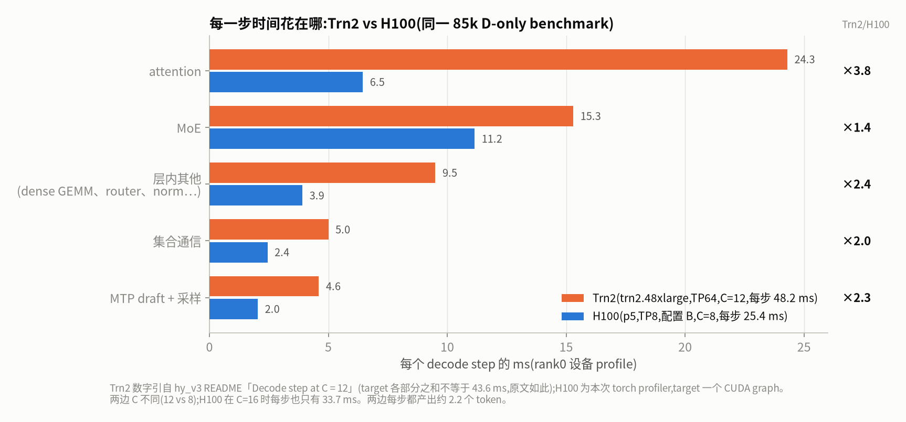
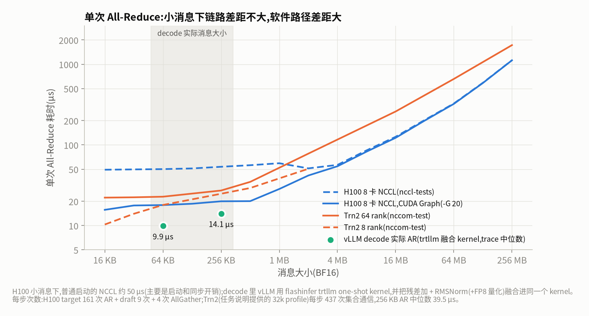
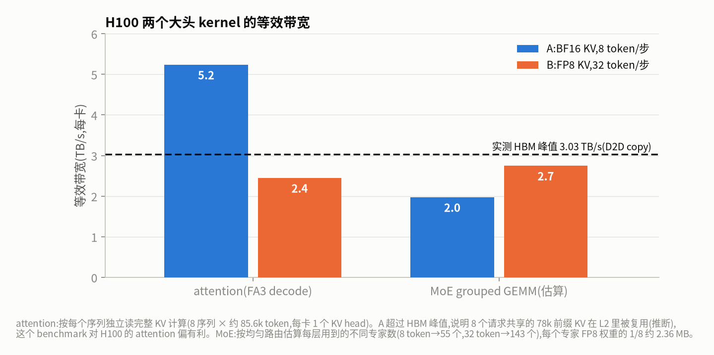
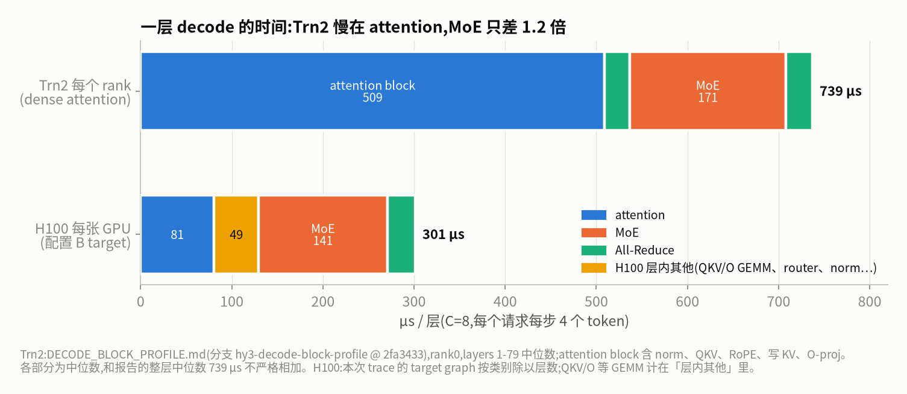
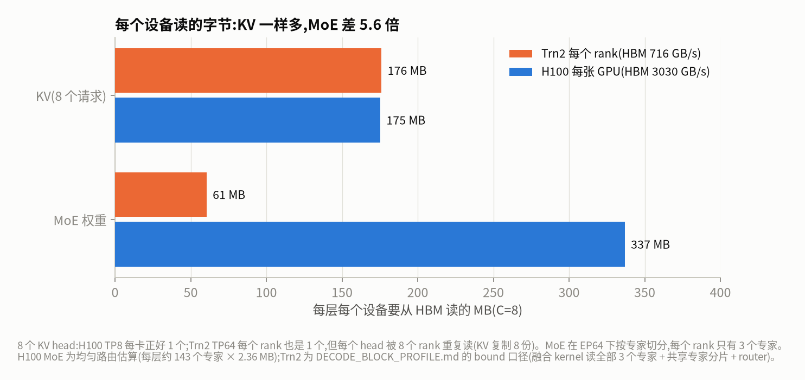
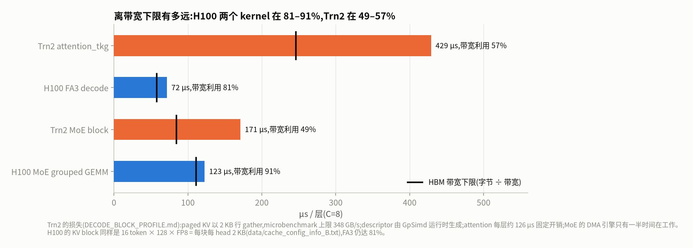
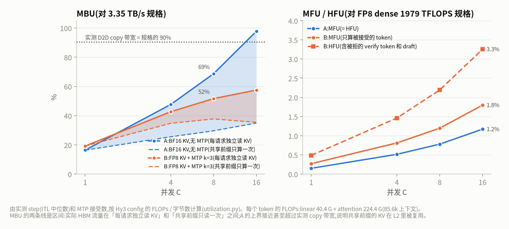
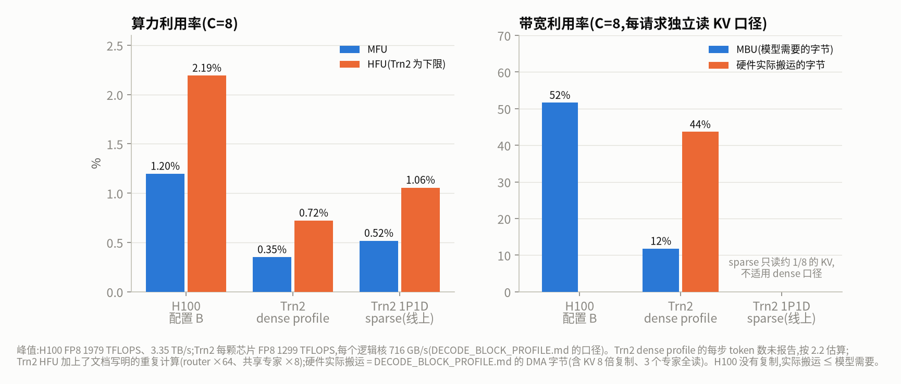

# H100 上的 Hy3-FP8 decode profile,以及它为什么比 Trn2 快

在一台 p5.48xlarge(8× H100 80GB)上,用和 Trn2 相同的 85k D-only benchmark,抓了 Hy3-FP8 的通信、decode 和 prefill profile,用来解释同一个模型 TPOT 11.0 ms(H100)对 19.7 ms(Trn2)的差距。

**结论**
- 两边每步都产出约 2.2 个 token(MTP 接受率一样),所以 TPOT 的差距全部来自 decode step 的时长:H100 每步 25 ms,Trn2 约 44 ms。
- 差距主要不在硬件带宽。trn2.48xlarge 整机的 HBM 带宽按规格比 p5 还高(16 × 2.9 ≈ 46 TB/s,p5 是 8 × 3.35 ≈ 27 TB/s);8 卡 NVLink 和 Trn2 片内互联在小消息下的延迟也差不多。
- H100 快在 batch 8 这种很小的工作量下,几乎每一部分都更接近硬件上限:
  - 整步在一个 CUDA graph 里跑完,GPU 空闲只有约 3%;MTP draft 只占 1.75 ms。
  - TP8 每步的集合通信只有约 170 次,而且用的是和 RMSNorm 融合的 one-shot kernel,单次 10–14 µs。
  - MoE 的 grouped GEMM 估算能跑到 HBM 峰值的约 90%。
- 差距最大的是 attention(Trn2 24.3 ms,H100 6.5 ms)。和 Trn2 的逐层 DMA profile([DECODE_BLOCK_PROFILE.md](https://github.com/qingzwang/vllm-neuron/blob/hy3-decode-block-profile/contrib/models/hy_v3/docs/DECODE_BLOCK_PROFILE.md),第 5 节)对照后,原因可以拆成两层:
  - **字节分布相反**:Hy3 只有 8 个 KV head,TP64 下每个 KV head 被 8 个 rank 重复读,所以一个 Trn2 rank 每层要读的 KV(176 MB)和一整张 H100 一样多,而它的带宽只有 H100 的 1/4.2;MoE 在 EP64 下按专家切分,一个 rank 只需要读 61 MB,是 H100 一张卡的 1/5.6。所以 Trn2 的大头是 attention,H100 的大头是 MoE。
  - **效率差**:H100 的两个大头 kernel 跑到带宽下限的 81–91%;Trn2 只有 49–57%,损失在 2 KB 行的 paged gather、由 GpSimd 生成 descriptor,以及每层固定开销。
- MFU / HFU / MBU(第 6 节):decode 的算术强度只有 5–33 FLOP/B,远低于拐点(H100 591、Trn2 454),所以 C=8 时 MFU 只有 1.2%(H100)和 0.35–0.52%(Trn2),这是正常的,要看的是 MBU。H100 配置 B 的 MBU 是 38–52%。Trn2 dense 的硬件实际搬运带宽是 44%,但其中只有 27% 是模型需要的字节,按模型口径的 MBU 只有 12%。
- 共享前缀的 L2 复用(图 5,推断)只在 BF16 KV 的配置 A 上明显。FP8 KV 的配置 B 是 2.4 TB/s,没有超过 HBM 峰值,所以上面的结论不依赖这一点。

## 1. H100 的 decode step 随并发线性增长,没有被固定开销卡住

- **配置 B 和参考值对得上**:配置 B(FP8 KV + MTP k=3,即 `scripts/pd/gpu/gpu_single_serve.sh`)在 C=8 时 TPOT 11.2 ms、step 25.0 ms,和客户 GPU 参考的 11.0 / 约 25 ms 一致。配置 A(BF16 KV,不开 MTP)的 C=8 是 17.1 ms,和 H100 1P1D 的 D-only 结果 17.09 ms 一致。
- **step 随 batch 增长**:从 C=1 到 C=16,配置 A 的 step 从 11.1 ms 涨到 22.9 ms,配置 B 从 14.1 ms 涨到 33.7 ms,说明 H100 一直在随工作量增长。Trn2 那边,按 [DECODE_BLOCK_PROFILE.md](https://github.com/qingzwang/vllm-neuron/blob/hy3-decode-block-profile/contrib/models/hy_v3/docs/DECODE_BLOCK_PROFILE.md)(dense attention),c1 的 target 是 32.5 ms,其中 80 层每层的固定开销(attention 约 126 µs、block 胶水约 46 µs、两次 AR)占了一半以上:Trn2 的固定开销是每层都有一份,不是每步一份。
- **Trn2 在 C=8 的 step(约 44 ms)比 H100 在 C=16 的 step(33.7 ms)还长**。

## 2. 每一部分 H100 都更快,attention 差得最多

Trn2 的数据引自本 README「Decode step at C = 12」的 rank0 设备 profile,和这次是同一个 85k / 92% 前缀的 D-only benchmark,但 C=12。H100 的数据是 C=8。

| 部分 | Trn2 / H100 | 说明 |
|---|---|---|
| attention | ×3.8 | 差距最大的一项,但需要注意 benchmark 对 H100 有利(第 4 节) |
| 层内其他(dense GEMM、router、norm 等) | ×2.4 | H100 上很多 norm 和量化已经融合进 AR kernel 里了 |
| MTP draft + 采样 | ×2.3 | H100 的 3 次 draft 前向各是一个只有 1 层的小 graph,一共 1.75 ms;graph 外的采样和拒绝采样只有 0.29 ms |
| 集合通信 | ×2.0 | 见第 3 节 |
| MoE | ×1.4 | 差距最小,H100 这里已经接近带宽上限(第 4 节) |

## 3. 通信:差在次数和软件路径,不在链路

- **链路差距不大**:decode 的 AR 消息是 64–256 KB。在这个区间,H100 8 卡 NCCL(CUDA Graph 模式)是 18–20 µs,Trn2 nccom-test 8 rank 是 18–25 µs,64 rank 是 23–27 µs。
- **软件路径差距大**:vLLM decode 用的不是 NCCL,而是 flashinfer 的 trtllm one-shot lamport kernel,并且把残差加、RMSNorm 和 FP8 量化融合进了同一个 kernel。trace 里单次中位数是 9.9 µs(64 KB)和 14.1 µs(256 KB),比 NCCL 的 CUDA Graph 模式还快 1.4–1.8 倍。
- **次数差距大**:H100 每步约 174 次集合通信(161 次 AR + 9 次 draft AR + 4 次 AllGather)。Trn2 的 TP64/EP64 每步有 437 次集合通信(这个数字来自 32k 的 profile),其中 256 KB AR 的中位数是 39.5 µs。

## 4. H100 一步的构成,以及两个大头 kernel 的效率

- MoE 加 attention 占了一步的七成左右,集合通信约一成,GPU 空闲约 3%。
- 从 A(每步 8 个 token)到 B(target 每步 32 个 token),多出来的 8 ms 里约 5 ms 是 MoE:token 多了,用到的专家也多了。attention 只增加了约 0.8 ms,因为 KV 改成 FP8 后读的数据量减半,抵消了大部分增长。
- B 的一步里,target 前向是一个 2150 个 kernel 的 graph(23.96 ms)。3 次 draft 前向分在两个小 graph 里(0.66 ms + 1.09 ms);graph 外的 kernel 一共 0.29 ms。

- **MoE**:按均匀路由估算,每层每卡要读的专家权重,8 个 token 时约 131 MB,32 个 token 时约 337 MB。实测每层 66 µs / 123 µs,折合 2.0 / 2.75 TB/s,已经是实测 HBM 峰值(3.03 TB/s)的 65% / 91%。
- **attention(BF16 KV)**:如果每个序列都独立读自己完整的 KV,等效带宽是 **5.2 TB/s**,超过了 HBM 峰值。最可能的原因是 8 个请求共享同一段 78k 前缀(前缀缓存让它们指向同一批物理 block),这部分 KV 在 50 MB 的 L2 里被复用了(推断)。所以在这个 benchmark 下,H100 的 attention 时间比请求之间不共享前缀的真实负载要好看。下一步可以用 `bench_data/prompts/in85000_c8`(不共享前缀)复测来验证。

## 5. 逐层对比 Trn2 的 DMA profile

Trn2 的数据引自 [`docs/DECODE_BLOCK_PROFILE.md`](https://github.com/qingzwang/vllm-neuron/blob/hy3-decode-block-profile/contrib/models/hy_v3/docs/DECODE_BLOCK_PROFILE.md)(分支 `hy3-decode-block-profile` @ 2fa3433)。那是 trn2.48xlarge 上 TP64/EP64、FP8 KV、MTP k=3、融合 decode MoE、**dense attention**(不开 sparse)的 profile:c8(8 个请求 × 4 个 verify token)、rank0、layers 1–79 的中位数,target 每步 60.0 ms。H100 用的是本次配置 B 的 target graph:同样 8 个请求 × 4 个 token,每步 24.0 ms。

| 每层 | Trn2 每个 rank | H100 每张 GPU | 倍数 |
|---|---|---|---|
| attention kernel | 429 µs(`attention_tkg`) | 72 µs(FA3) | ×6.0 |
| attention block(含 norm、QKV、RoPE、写 KV、O-proj) | 509 µs | 约 130 µs(attention 81 + 层内其他 49) | ×3.9 |
| MoE | 171 µs(融合 kernel,含 norm、router、共享专家) | 141 µs(其中 grouped GEMM 123 µs) | ×1.2 |
| 两次 All-Reduce | 28 + 29 µs,基本不和计算重叠 | 合计 31 µs(已融合 RMSNorm / FP8 量化) | ×1.9 |
| **一层** | **739 µs** | **301 µs** | **×2.5** |

### 为什么 Trn2 的大头是 attention,H100 的大头是 MoE:每个设备读的字节正好相反

- **KV 一样多**:Hy3 只有 8 个 KV head。H100 的 TP8 每卡正好分到 1 个,没有重复。Trn2 的 TP64 每个 rank 也只放 1 个 KV head,但每个 head 要被 8 个 rank 各读一遍(Trn2 报告和本 README 的 KVDP 一节都写明了 KV 复制 8 份)。结果是一个 Trn2 rank 要读的 KV(176 MB/层)和一整张 H100(175 MB/层)一样多,可它的 HBM 带宽是 716 GB/s,只有 H100 实测 3030 GB/s 的 1/4.2。
- **MoE 差 5.6 倍**:EP64 按专家切分,没有重复,一个 rank 只有 3 个专家,每层读 61 MB(融合 kernel 读全部 3 个专家 + 共享专家分片 + router)。H100 每卡存每个专家的 1/8,32 个 token 每层约用到 143 个专家,要读约 337 MB(均匀路由估算)。
- **结论**:Trn2 上 KV 是 MoE 的 2.9 倍,H100 上 MoE 是 KV 的 1.9 倍。两边按带宽算的下限也是这样:Trn2 attention 246 µs 对 MoE 85 µs,H100 attention 58 µs 对 MoE 111 µs。所以 Trn2 的大头是 attention,H100 的大头是 MoE。

### 离带宽下限有多远

- **H100**:FA3 跑到下限的 81%,MoE grouped GEMM 跑到约 91%。
- **Trn2**:`attention_tkg` 只有 57%,MoE block 只有 49%。报告找到的原因:
  - **attention**:paged KV 以 2 KB 行做 gather,DMA microbenchmark 显示这种访问最高只有 348 GB/s,只有 HBM 的一半;gather 的 descriptor 由 GpSimd 在运行时生成,GpSimd 有三分之二的时间忙在这上面;kernel 是 gather K → QK^T → softmax → gather V → PV 的串行链,每个 128-token tile 只有 4 个 query 列(1 个 Q head × 4 个 verify token);另外每层还有约 126 µs 的固定开销。
  - **MoE**:权重行是连续的,本来可以跑到约 600 GB/s,但 DMA 引擎只有 51% 的时间在工作。
- **同样是 2 KB 的粒度,H100 不受影响**:H100 上 vLLM 用的是 16-token 的 block(`data/cache_config_info_B.txt`),FP8 下每块每个 head 的 K 也正好是 2 KB,但 FA3 仍有 81%。GPU 是由很多 SM 直接发 load,同时在途的请求很多,没有生成 descriptor 这一步(Trn2 报告最后一节也是这么总结的)。
- **attention 的差距可以这样拆**:每个设备的带宽差 4.2 倍(这是 KV 复制带来的),乘以效率差约 1.4 倍(81% 对 57%),约等于 6 倍。

### 对 Trn2 的含义

- **报告列出的优化**:喂满 attention 的 DMA、加大 KV 块、喂满 MoE 的 DMA、在 AR 期间预取、合并胶水操作。按报告的估算,这些加起来能省 21–26 ms/步,dense 的 target 可以从 60 ms 降到约 35–39 ms。
- **只做这些还不够**:即使 attention 跑满 716 GB/s,下限也有 246 µs × 80 ≈ 20 ms,比 H100 整步的 attention(6.5 ms)多 3 倍。要接近 H100,还需要**去掉 KV 的 8 倍复制**:用 KVDP 或 DCP 让共享同一个 KV head 的 8 个 rank 分工读,c8 时每个 rank 每层只读 22 MB,下限约 31 µs。或者像线上配置那样用 sparse decode 减少要读的字节。
- **MoE 这边**:Trn2 每个 rank 的 MoE 下限(85 µs)本来比 H100 每张卡的(111 µs)还低,所以把 DMA 喂满后,有机会比 H100 更快。

## 6. MFU / HFU / MBU

**口径**(每个 decode step,整机;计算脚本 `utilization.py`,结果在 `data/utilization.json`):
- **MFU**:有效模型 FLOPs ÷(步长 × 峰值 FLOPs)。有效 FLOPs = 产出的 token 数(开 MTP 时只算被接受的)× 每个 token 的 dense 模型 FLOPs。每个 token 的 FLOPs 是 linear 40.4 G(2 × 激活参数 20.2B)加上 attention 224.4 G(4 × 64 head × 128 × 85.6k 上下文 × 80 层)。
- **HFU**:实际执行的 FLOPs ÷(步长 × 峰值 FLOPs)。执行 FLOPs = target 实际 verify 的全部 token(C × 4,包括被拒的)+ MTP draft 的 3 次前向 + 跨 rank 的重复计算。Trn2 的重复计算按文档写明的部分算(router ×64、共享专家 ×8),所以是下限。
- **MBU**:模型需要读的 HBM 字节 ÷(步长 × 峰值带宽)。需要的字节包括:各层 attention 权重、dense 层、lm_head、router、被某个 token 选中的专家加上共享专家(按均匀路由估算),以及每个请求自己完整上下文的 KV。不计复制和缓存复用。
  - 因为这个 benchmark 里请求共享 78k 前缀,另外给一个"共享前缀只读一次"的下界。实际 HBM 流量在这两者之间。
- **硬件实际搬运**(只有 Trn2):Trn2 报告里实测的 DMA 字节,这是带宽方向上和 HFU 对应的量。
- **峰值**(规格值):H100 FP8 dense 1979 TFLOPS、3.35 TB/s;Trn2 每颗芯片 FP8 dense 1299 TFLOPS,每个逻辑核 716 GB/s。

| 配置 | C | step (ms) | 有效 token/步 | MFU | HFU | MBU(共享前缀只算一次 ~ 每请求独立) | 需读字节/步 (GB) | 算术强度 FLOP/B(拐点) | 硬件实际搬运 |
|---|---|---|---|---|---|---|---|---|---|
| H100 A | 1 | 11.1 | 1.0 | 0.15% | 0.15% | 16% ~ 16% | 49 ~ 49 | 5(591) | — |
| H100 A | 4 | 13.0 | 4.0 | 0.52% | 0.52% | 26% ~ 48% | 89 ~ 166 | 6(591) | — |
| H100 A | 8 | 17.2 | 8.0 | 0.78% | 0.78% | 30% ~ 69% | 136 ~ 316 | 7(591) | — |
| H100 A | 16 | 22.9 | 16.0 | 1.17% | 1.17% | 35% ~ 98% | 214 ~ 599 | 7(591) | — |
| H100 B | 1 | 14.1 | 2.3 | 0.27% | 0.49% | 19% ~ 19% | 72 ~ 72 | 15(591) | — |
| H100 B | 4 | 18.8 | 9.1 | 0.81% | 1.46% | 35% ~ 43% | 175 ~ 215 | 20(591) | — |
| H100 B | 8 | 25.0 | 17.9 | 1.20% | 2.19% | 38% ~ 52% | 253 ~ 346 | 25(591) | — |
| H100 B | 16 | 33.7 | 36.2 | 1.80% | 3.25% | 35% ~ 58% | 320 ~ 519 | 33(591) | — |
| Trn2 dense profile | 8 | 64.0 | 17.6 | 0.35% | 0.72% | 9% ~ 12% | 253 ~ 346 | 28(454) | 1280 GB,44% |
| Trn2 1P1D sparse | 8 | 43.8 | 17.8 | 0.52% | 1.06% | — | — | —(454) | — |

**怎么读**
- **MFU 只有 1–2%,这在 decode 里是正常的**。算术强度只有 5–33 FLOP/B,而 H100 的拐点是 591 FLOP/B,Trn2 是 454 FLOP/B,所以 decode 一定受带宽限制。即使 MBU 达到 100%,HFU 的上限也只有"强度 ÷ 拐点"。配置 B 在 C=8 时这个上限约 4%,实际 HFU 是 2.2%,和 52% 的 MBU 对得上。要看的指标是 MBU,不是 MFU。
- **85k 上下文时,attention 占了每个 token 85% 的 FLOPs**(224 G 对 40 G)。所以 MFU 主要由 attention 决定,而 MoE 的成本主要体现在字节上(MBU),不体现在 FLOPs 上。
- **MTP 让 HFU 约等于 1.8 倍 MFU**:每步 verify 4 个 token,平均只接受 2.24 个,另外还要跑 3 次 draft。这部分是 MTP 本来就要付的计算,但它换来了更低的 TPOT。
- **H100 的 MBU 随并发上升**:配置 B 从 C=1 的 19% 升到 C=16 的 58%(上界)。C=1 时只用了约五分之一的带宽,剩下的时间都是 kernel 启动和串行依赖的延迟。配置 A 在 C=16 时上界是 98%,超过了实测的 copy 带宽(规格的 90%),这就是共享前缀的 KV 在 L2 里被复用的证据,所以配置 A 的真实 MBU 介于两条线之间,而且偏向下界。
- **Trn2 的硬件其实不闲,但大部分字节是重复的**。dense profile 里硬件实际搬运的带宽利用率是 44%,和 H100 的 52% 相差不大。但每步搬运的 1280 GB 是模型实际需要的(346 GB)的 3.7 倍:KV 复制了 8 份,融合 MoE 把每个 rank 上的 3 个专家都读了一遍。所以按模型需要的字节算,MBU 只有 12%。这和第 5 节的结论一致。
- **注意事项**:
  - 均匀路由会高估要读的专家数,所以 MBU 偏高估计。
  - Trn2 dense profile 没有报告每步接受的 token 数,这里按 2.2 估算(D-only chat 重放下是 2.19–2.23)。
  - 线上 Trn2 的 sparse 配置只读约 1/8 的 KV,不适用 dense 口径的 MBU,所以只给了 MFU 和 HFU。

## 7. prefill(配置 B,C=1,一个请求)

| 请求 | TTFT(不开 profiler) | GPU 时间(rank0) | 主要构成 |
|---|---|---|---|
| 85k,92.1% 前缀命中 | 792 ms | 554 ms(只有 1 个 8192-token chunk) | attention 327 ms,MoE grouped GEMM 72 ms,AR 38 ms |
| 85k 冷启动 | 4.67 s | 4.86 s(11 个 chunk,开着 profiler) | attention 1.85 s,AR 0.88 s,MoE grouped GEMM 0.83 s |

prefill 的 AR 走的是 `multimem_all_reduce_kernel`(SYMM_MEM),每次约 225–262 µs。92% 命中、开着 profiler 的那次请求,TTFT 是 809 ms,GPU 时间是 554 ms,多出来的约 250 ms 在 GPU 之外(85k token 的 tokenize、调度等)。

## 方法

- **环境**:vLLM 0.29.0(`vllm/vllm-openai:v0.29.0`,torch 2.13 + CUDA 13.0,flashinfer 0.6.18),TP=8,`VLLM_FLASHINFER_ALLREDUCE_BACKEND=trtllm`,max_model_len 87040,单机,不做 PD。各后端由 vLLM 自动选择:FA3 attention、FLASHINFER_CUTLASS FP8 MoE、启用 `allreduce_rms` 融合。
- **两个配置的完整命令**:`data/serve_cmd_A.txt` 和 `data/serve_cmd_B.txt`。配置 A 是 `gpu_serve.sh` 的参数去掉 Mooncake connector;配置 B 是 `gpu_single_serve.sh`。两者都只额外加了 `--profiler-config`。
- **benchmark**:`scripts/bench_donly.sh`,是 `scripts/pd/pd_bench_dcust.sh` 的单 server 版本。先把 c8 文件里的 80 个 prompt 各发一次(输出 1 个 token)存进前缀缓存,再用同一个 `cache_salt` 重放 10×C 个请求。输出 1200 token,`--ignore-eos`,temperature 0.9,seed 0。重放时前缀命中率是 100%。
- **profile**:用 vLLM 自带的 torch profiler,在 C=8 稳定 decode 时抓 3 秒(`scripts/prof_decode_run.sh`)。graph 内部的 kernel 都能看到(每个 rank 约 30–39 万个 kernel)。
  - 计步 kernel:A 用 `_gumbel_sample_kernel`(178 步),B 用 `_rejection_kernel`(121 步);窗口时长除以步数,和 ITL 中位数的误差在 2% 以内。
  - 8 个 rank 之间的差别在 ±2% 以内。
  - 分类:`scripts/prof_summary.py` 只按名字正则分类,会把 MoE 的 grouped GEMM 归进 gemm。图里用的是 `scripts/prof_detail.py` 的细分:按 `graph id` 区分 target 和 draft,把 FLASHINFER_CUTLASS MoE 的 kernel 归到 MoE。
- **通信和带宽**:nccl-tests 2.21.1 + NCCL 2.30.7,8 卡,BF16,`-w 20 -n 100`,分普通模式和 `-G 20`(CUDA Graph)两组;HBM 用 4 GiB 的 D2D copy 测。
- **注意**:开着 profiler 的那一轮,`stop_profile` 写 trace 时 engine 会停住约 9 分钟,所以那一轮的 TPOT 均值不能用,只有 ITL 中位数可以用。这次只采集了数据,没有做任何调优,也没有改模型代码。

## 文件

- `figs/`:图,由 `plot_figs.py` 生成(数据从 `data/` 里读;Trn2 的数字在脚本里注明了出处)。
- `data/RESULTS_raw.md`:按采集任务模板填写的完整结果和偏差说明。
- `data/decode_sweep/`:每个配置、每个并发的 `vllm bench serve` 完整输出和 JSON(JSON 里加了前缀命中率和 MTP 接受率)。
- `data/prof_decode/{A,B}/`:8 个 rank 的汇总(`summary.txt`)和 rank0 的细分(`detail_rank0.txt`);`data/prof_prefill*/`:prefill 的汇总。
- `data/nccl/`、`data/hbm/`、`data/env.txt`、`data/server_*.log`(vLLM 自动选择的后端都在 server log 里)。
- `scripts/`:采集用的脚本。
- `utilization.py`:MFU / HFU / MBU 的计算,口径和假设写在文件开头;输入是 `data/hy3_config_subset.json`(模型 config 的相关字段)和 decode 扫描的 JSON;输出是 `data/utilization.json` 和 `data/utilization_table.md`。
- `data/cache_config_info_B.txt`:配置 B server 的 `vllm:cache_config_info`(block_size 16,FP8 KV)。
- 第 2 节和第 5 节的 Trn2 数据分别引自本 README「Decode step at C = 12」和 [`docs/DECODE_BLOCK_PROFILE.md`](https://github.com/qingzwang/vllm-neuron/blob/hy3-decode-block-profile/contrib/models/hy_v3/docs/DECODE_BLOCK_PROFILE.md)(分支 `hy3-decode-block-profile` @ 2fa3433);`plot_figs.py` 里逐个注明了出处。
- 原始 torch trace(1.7 GB)没有放进仓库。

## 附录:图中数据

| C | A step / TPOT (ms) | B step / TPOT (ms) | B MTP 每步 token |
|---|---|---|---|
| 1 | 11.1 / 11.1 | 14.1 / 6.2 | 2.28 |
| 4 | 13.0 / 13.0 | 18.8 / 8.3 | 2.28 |
| 8 | 17.2 / 17.1 | 25.0 / 11.2 | 2.24 |
| 16 | 22.9 / 22.9 | 33.7 / 14.8 | 2.26 |

| 每步 ms(rank0) | attention | MoE | 层内其他 | 集合通信 | draft + 采样 | 每步合计 |
|---|---|---|---|---|---|---|
| Trn2,C=12(引用) | 24.3 | 15.3 | 9.5 | 5.0 | 4.6 | 48.2 |
| H100 B,C=8(target graph + draft) | 6.5 | 11.2 | 3.9 | 2.4 | 2.0 | 25.4 |

| H100 C=8 每步 ms | attention | MoE | 集合通信 | dense GEMM | 其他 kernel | GPU 空闲 | 实际每步 |
|---|---|---|---|---|---|---|---|
| A | 5.9 | 6.7 | 1.7 | 1.6 | 2.2 | 0.6 | 17.4 |
| B | 6.7 | 11.5 | 2.6 | 1.9 | 3.3 | 0.9 | 25.4 |

| AR 耗时 (µs) | 16 KB | 64 KB | 256 KB | 2 MB | 16 MB | 256 MB |
|---|---|---|---|---|---|---|
| H100 NCCL | 49.2 | 50.1 | 53.6 | 51.2 | 126.0 | 1122.4 |
| H100 NCCL(CUDA Graph) | 15.7 | 17.9 | 20.0 | 41.8 | 122.5 | 1119.4 |
| Trn2 64 rank | 22.2 | 22.8 | 27.2 | 78.0 | 259.6 | 1726.4 |
| Trn2 8 rank | 10.3 | 18.0 | 24.8 | 50.6 | — | — |
| vLLM decode 实测(trtllm 融合) | — | 9.9 | 14.1 | — | — | — |

| 等效带宽 (TB/s/卡) | A | B |
|---|---|---|
| attention(按每个序列独立读 KV 计算) | 5.2 | 2.4 |
| MoE grouped GEMM(均匀路由估算) | 2.0 | 2.75 |
| 实测 HBM 峰值 | 3.03 | 3.03 |

| 每层(C=8) | Trn2 每个 rank(引用) | H100 每张 GPU |
|---|---|---|
| attention block / 其中 attention kernel (µs) | 509 / 429 | 130 / 72 |
| MoE (µs) | 171 | 141(grouped GEMM 123) |
| 两次 AR (µs) | 57 | 31 |
| 一层 (µs) | 739 | 301 |
| KV 读取 (MB) | 176 | 175 |
| MoE 权重读取 (MB) | 61 | 337(估算) |
| HBM 带宽 (GB/s) | 716 | 3030 |
| attention 下限 / 利用率 | 246 µs / 57% | 58 µs / 81% |
| MoE 下限 / 利用率 | 85 µs / 49% | 111 µs / 91% |
