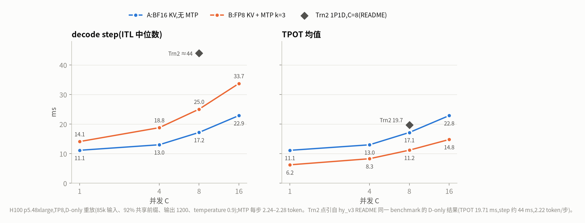
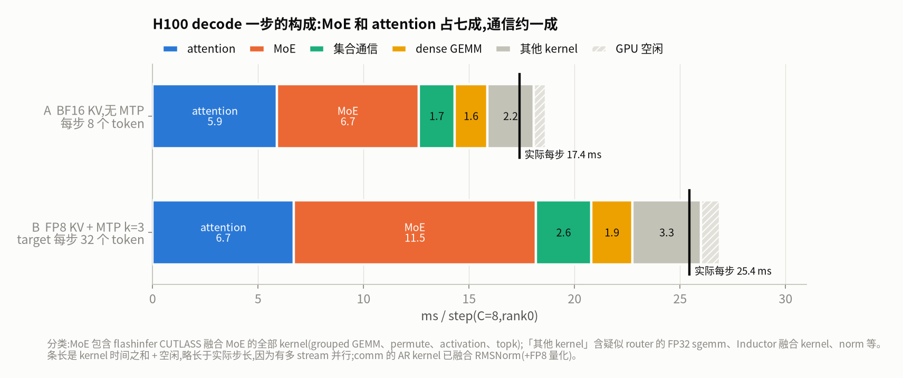

# H100 上的 Hy3-FP8 decode profile,以及它为什么比 Trn2 快

在一台 p5.48xlarge(8× H100 80GB)上,用和 Trn2 相同的 85k D-only benchmark,抓了 Hy3-FP8 的通信、decode 和 prefill profile,用来解释同一个模型 TPOT 11.0 ms(H100)对 19.7 ms(Trn2)的差距。

**结论**
- 两边每步都产出约 2.2 个 token(MTP 接受率一样),所以 TPOT 的差距全部来自 decode step 的时长:H100 每步 25 ms,Trn2 约 44 ms。
- 差距主要不在硬件带宽。trn2.48xlarge 整机的 HBM 带宽按规格比 p5 还高(16 × 2.9 ≈ 46 TB/s,p5 是 8 × 3.35 ≈ 27 TB/s);8 卡 NVLink 和 Trn2 片内互联在小消息下的延迟也差不多。
- H100 快在 batch 8 这种很小的工作量下,几乎每一部分都更接近硬件上限:
  - 整步在一个 CUDA graph 里跑完,GPU 空闲只有约 3%;MTP draft 只占 1.75 ms。
  - TP8 每步的集合通信只有约 170 次,而且用的是和 RMSNorm 融合的 one-shot kernel,单次 10–14 µs。
  - MoE 的 grouped GEMM 估算能跑到 HBM 峰值的约 90%。
- 差距最大的是 attention(Trn2 24.3 ms,H100 6.5 ms)。其中有一部分来自这个 benchmark 本身:8 个请求共享 78k 前缀,H100 的 L2 能复用这部分 KV(推断,见图 5),所以 H100 在这一项上可能被高估了。

## 1. H100 的 decode step 随并发线性增长,没有被固定开销卡住

- **配置 B 和参考值对得上**:配置 B(FP8 KV + MTP k=3,即 `scripts/pd/gpu/gpu_single_serve.sh`)在 C=8 时 TPOT 11.2 ms、step 25.0 ms,和客户 GPU 参考的 11.0 / 约 25 ms 一致。配置 A(BF16 KV,不开 MTP)的 C=8 是 17.1 ms,和 H100 1P1D 的 D-only 结果 17.09 ms 一致。
- **step 随 batch 增长**:从 C=1 到 C=16,配置 A 的 step 从 11.1 ms 涨到 22.9 ms,配置 B 从 14.1 ms 涨到 33.7 ms,说明 H100 一直在随工作量增长。Trn2 上 C=1/4/8 的 step 几乎不变,说明它主要被固定开销卡住。
- **Trn2 在 C=8 的 step(约 44 ms)比 H100 在 C=16 的 step(33.7 ms)还长**。

## 2. 每一部分 H100 都更快,attention 差得最多

Trn2 的数据引自本 README「Decode step at C = 12」的 rank0 设备 profile,和这次是同一个 85k / 92% 前缀的 D-only benchmark,但 C=12。H100 的数据是 C=8。

| 部分 | Trn2 / H100 | 说明 |
|---|---|---|
| attention | ×3.8 | 差距最大的一项,但需要注意 benchmark 对 H100 有利(第 4 节) |
| 层内其他(dense GEMM、router、norm 等) | ×2.4 | H100 上很多 norm 和量化已经融合进 AR kernel 里了 |
| MTP draft + 采样 | ×2.3 | H100 的 3 次 draft 前向各是一个只有 1 层的小 graph,一共 1.75 ms;graph 外的采样和拒绝采样只有 0.29 ms |
| 集合通信 | ×2.0 | 见第 3 节 |
| MoE | ×1.4 | 差距最小,H100 这里已经接近带宽上限(第 4 节) |

## 3. 通信:差在次数和软件路径,不在链路

- **链路差距不大**:decode 的 AR 消息是 64–256 KB。在这个区间,H100 8 卡 NCCL(CUDA Graph 模式)是 18–20 µs,Trn2 nccom-test 8 rank 是 18–25 µs,64 rank 是 23–27 µs。
- **软件路径差距大**:vLLM decode 用的不是 NCCL,而是 flashinfer 的 trtllm one-shot lamport kernel,并且把残差加、RMSNorm 和 FP8 量化融合进了同一个 kernel。trace 里单次中位数是 9.9 µs(64 KB)和 14.1 µs(256 KB),比 NCCL 的 CUDA Graph 模式还快 1.4–1.8 倍。
- **次数差距大**:H100 每步约 174 次集合通信(161 次 AR + 9 次 draft AR + 4 次 AllGather)。Trn2 的 TP64/EP64 每步有 437 次集合通信(这个数字来自 32k 的 profile),其中 256 KB AR 的中位数是 39.5 µs。

## 4. H100 一步的构成,以及两个大头 kernel 的效率

- MoE 加 attention 占了一步的七成左右,集合通信约一成,GPU 空闲约 3%。
- 从 A(每步 8 个 token)到 B(target 每步 32 个 token),多出来的 8 ms 里约 5 ms 是 MoE:token 多了,用到的专家也多了。attention 只增加了约 0.8 ms,因为 KV 改成 FP8 后读的数据量减半,抵消了大部分增长。
- B 的一步里,target 前向是一个 2150 个 kernel 的 graph(23.96 ms)。3 次 draft 前向分在两个小 graph 里(0.66 ms + 1.09 ms);graph 外的 kernel 一共 0.29 ms。

- **MoE**:按均匀路由估算,每层每卡要读的专家权重,8 个 token 时约 131 MB,32 个 token 时约 337 MB。实测每层 66 µs / 123 µs,折合 2.0 / 2.75 TB/s,已经是实测 HBM 峰值(3.03 TB/s)的 65% / 91%。
- **attention(BF16 KV)**:如果每个序列都独立读自己完整的 KV,等效带宽是 **5.2 TB/s**,超过了 HBM 峰值。最可能的原因是 8 个请求共享同一段 78k 前缀(前缀缓存让它们指向同一批物理 block),这部分 KV 在 50 MB 的 L2 里被复用了(推断)。所以在这个 benchmark 下,H100 的 attention 时间比请求之间不共享前缀的真实负载要好看。下一步可以用 `bench_data/prompts/in85000_c8`(不共享前缀)复测来验证。

## 5. prefill(配置 B,C=1,一个请求)

| 请求 | TTFT(不开 profiler) | GPU 时间(rank0) | 主要构成 |
|---|---|---|---|
| 85k,92.1% 前缀命中 | 792 ms | 554 ms(只有 1 个 8192-token chunk) | attention 327 ms,MoE grouped GEMM 72 ms,AR 38 ms |
| 85k 冷启动 | 4.67 s | 4.86 s(11 个 chunk,开着 profiler) | attention 1.85 s,AR 0.88 s,MoE grouped GEMM 0.83 s |

prefill 的 AR 走的是 `multimem_all_reduce_kernel`(SYMM_MEM),每次约 225–262 µs。92% 命中、开着 profiler 的那次请求,TTFT 是 809 ms,GPU 时间是 554 ms,多出来的约 250 ms 在 GPU 之外(85k token 的 tokenize、调度等)。

## 方法

- **环境**:vLLM 0.29.0(`vllm/vllm-openai:v0.29.0`,torch 2.13 + CUDA 13.0,flashinfer 0.6.18),TP=8,`VLLM_FLASHINFER_ALLREDUCE_BACKEND=trtllm`,max_model_len 87040,单机,不做 PD。各后端由 vLLM 自动选择:FA3 attention、FLASHINFER_CUTLASS FP8 MoE、启用 `allreduce_rms` 融合。
- **两个配置的完整命令**:`data/serve_cmd_A.txt` 和 `data/serve_cmd_B.txt`。配置 A 是 `gpu_serve.sh` 的参数去掉 Mooncake connector;配置 B 是 `gpu_single_serve.sh`。两者都只额外加了 `--profiler-config`。
- **benchmark**:`scripts/bench_donly.sh`,是 `scripts/pd/pd_bench_dcust.sh` 的单 server 版本。先把 c8 文件里的 80 个 prompt 各发一次(输出 1 个 token)存进前缀缓存,再用同一个 `cache_salt` 重放 10×C 个请求。输出 1200 token,`--ignore-eos`,temperature 0.9,seed 0。重放时前缀命中率是 100%。
- **profile**:用 vLLM 自带的 torch profiler,在 C=8 稳定 decode 时抓 3 秒(`scripts/prof_decode_run.sh`)。graph 内部的 kernel 都能看到(每个 rank 约 30–39 万个 kernel)。
  - 计步 kernel:A 用 `_gumbel_sample_kernel`(178 步),B 用 `_rejection_kernel`(121 步);窗口时长除以步数,和 ITL 中位数的误差在 2% 以内。
  - 8 个 rank 之间的差别在 ±2% 以内。
  - 分类:`scripts/prof_summary.py` 只按名字正则分类,会把 MoE 的 grouped GEMM 归进 gemm。图里用的是 `scripts/prof_detail.py` 的细分:按 `graph id` 区分 target 和 draft,把 FLASHINFER_CUTLASS MoE 的 kernel 归到 MoE。
- **通信和带宽**:nccl-tests 2.21.1 + NCCL 2.30.7,8 卡,BF16,`-w 20 -n 100`,分普通模式和 `-G 20`(CUDA Graph)两组;HBM 用 4 GiB 的 D2D copy 测。
- **注意**:开着 profiler 的那一轮,`stop_profile` 写 trace 时 engine 会停住约 9 分钟,所以那一轮的 TPOT 均值不能用,只有 ITL 中位数可以用。这次只采集了数据,没有做任何调优,也没有改模型代码。

## 文件

- `figs/`:图,由 `plot_figs.py` 生成(数据从 `data/` 里读;Trn2 的数字在脚本里注明了出处)。
- `data/RESULTS_raw.md`:按采集任务模板填写的完整结果和偏差说明。
- `data/decode_sweep/`:每个配置、每个并发的 `vllm bench serve` 完整输出和 JSON(JSON 里加了前缀命中率和 MTP 接受率)。
- `data/prof_decode/{A,B}/`:8 个 rank 的汇总(`summary.txt`)和 rank0 的细分(`detail_rank0.txt`);`data/prof_prefill*/`:prefill 的汇总。
- `data/nccl/`、`data/hbm/`、`data/env.txt`、`data/server_*.log`(vLLM 自动选择的后端都在 server log 里)。
- `scripts/`:采集用的脚本。
- 原始 torch trace(1.7 GB)没有放进仓库。

## 附录:图中数据

| C | A step / TPOT (ms) | B step / TPOT (ms) | B MTP 每步 token |
|---|---|---|---|
| 1 | 11.1 / 11.1 | 14.1 / 6.2 | 2.28 |
| 4 | 13.0 / 13.0 | 18.8 / 8.3 | 2.28 |
| 8 | 17.2 / 17.1 | 25.0 / 11.2 | 2.24 |
| 16 | 22.9 / 22.9 | 33.7 / 14.8 | 2.26 |

| 每步 ms(rank0) | attention | MoE | 层内其他 | 集合通信 | draft + 采样 | 每步合计 |
|---|---|---|---|---|---|---|
| Trn2,C=12(引用) | 24.3 | 15.3 | 9.5 | 5.0 | 4.6 | 48.2 |
| H100 B,C=8(target graph + draft) | 6.5 | 11.2 | 3.9 | 2.4 | 2.0 | 25.4 |

| H100 C=8 每步 ms | attention | MoE | 集合通信 | dense GEMM | 其他 kernel | GPU 空闲 | 实际每步 |
|---|---|---|---|---|---|---|---|
| A | 5.9 | 6.7 | 1.7 | 1.6 | 2.2 | 0.6 | 17.4 |
| B | 6.7 | 11.5 | 2.6 | 1.9 | 3.3 | 0.9 | 25.4 |

| AR 耗时 (µs) | 16 KB | 64 KB | 256 KB | 2 MB | 16 MB | 256 MB |
|---|---|---|---|---|---|---|
| H100 NCCL | 49.2 | 50.1 | 53.6 | 51.2 | 126.0 | 1122.4 |
| H100 NCCL(CUDA Graph) | 15.7 | 17.9 | 20.0 | 41.8 | 122.5 | 1119.4 |
| Trn2 64 rank | 22.2 | 22.8 | 27.2 | 78.0 | 259.6 | 1726.4 |
| Trn2 8 rank | 10.3 | 18.0 | 24.8 | 50.6 | — | — |
| vLLM decode 实测(trtllm 融合) | — | 9.9 | 14.1 | — | — | — |

| 等效带宽 (TB/s/卡) | A | B |
|---|---|---|
| attention(按每个序列独立读 KV 计算) | 5.2 | 2.4 |
| MoE grouped GEMM(均匀路由估算) | 2.0 | 2.75 |
| 实测 HBM 峰值 | 3.03 | 3.03 |
